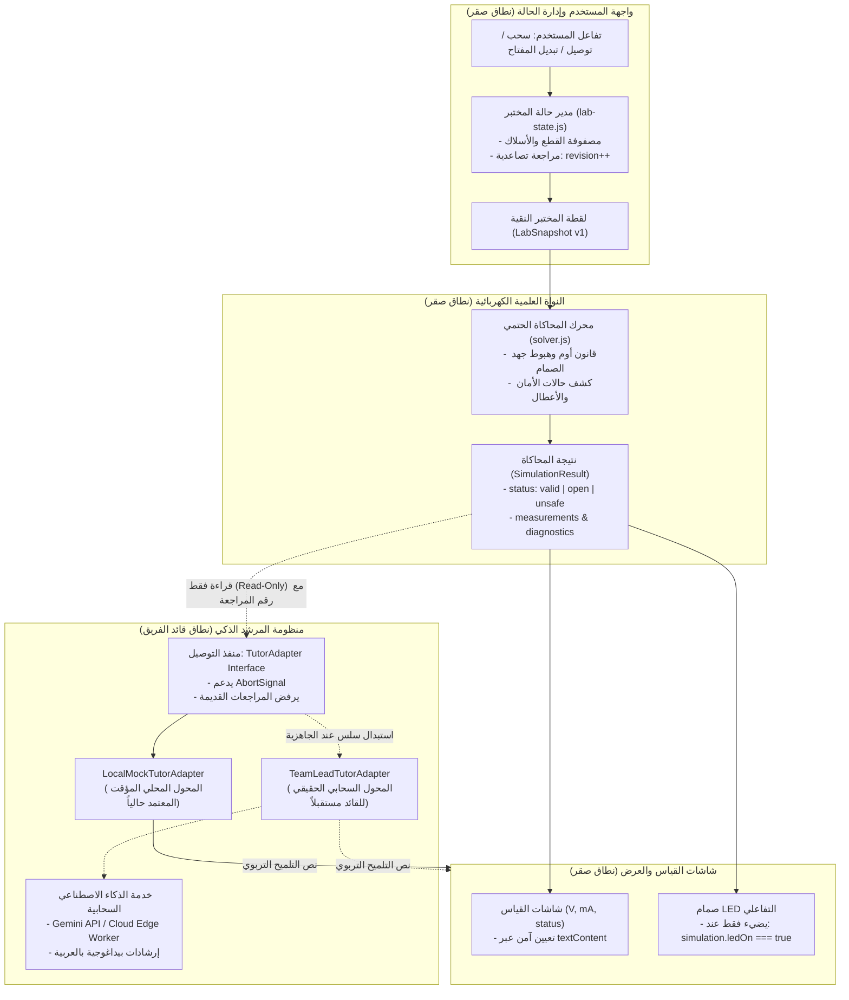

# حزمة تسليم التكامل المعماري والذكاء الاصطناعي — TEAM_INTEGRATION_PACKET.md
> **الموجه إلى:** قائد الفريق (مسؤول الذكاء الاصطناعي والتكامل السحابي)  
> **الإصدار المعماري:** v1.0.0 (DRAFT) — 24 نوفمبر 2026  
> **حالة العقد:** `DRAFT_VERIFIED` (معتمد برمجياً وجاهز للربط النهائي فور توفير خدمة القائد)

---

## 1. مخطط تدفق البيانات والتكامل (Data Flow Architecture)



---

## 2. واجهات النواة العلمية (Domain Interfaces)

كافة التعريفات موثقة ومطابقة في الملف [`src/domain/circuit/types.ts`](../src/domain/circuit/types.ts):

### أ. نموذج لقطة المختبر (`LabSnapshot`):
```typescript
export interface LabSnapshot {
  schemaVersion: 1;
  experimentId: 'ohms-law-led';
  revision: number; // رقم المراجعة الحتمي المتصاعد
  components: CircuitComponent[];
  wires: Wire[];
}
```

### ب. نموذج نتيجة المحاكاة (`SimulationResult`):
```typescript
export interface SimulationResult {
  modelVersion: '1.0.0';
  status: 'valid' | 'open' | 'unsafe' | 'unsupported';
  values: {
    circuitCurrentA: number | null;     // قيمة التيار بالأمبير (أو null في الحالات غير الآمنة)
    resistorVoltageV: number | null;    // هبوط الجهد على المقاومة بالفولت
    ledForwardVoltageV: number | null;  // هبوط الجهد على الصمام بالفولت
  };
  ledOn: boolean;                       // حالة إضاءة الصمام (true حصراً عند valid)
  diagnostics: Diagnostic[];            // قائمة رسائل التشخيص وأكواد الأعطال
}
```

### ج. أكواد الأعطال والتشخيص المدعومة رسمياً:
| كود التشخيص (`code`) | الحالة (`status`) | مستوى الخطورة | الوصف العلمي بالعربية |
|---|---|---|---|
| `OK` | `valid` | `info` | التوصيل سليم والدائرة مكتملة والصمام يضيء بثبات. |
| `REVERSED_LED` | `open` | `warning` | الصمام موصل بقطبية معكوسة (انحياز عكسي، المصعد بالجهة السالبة). |
| `MISSING_RESISTOR` | `unsafe` | `error` | خطر: الصمام موصول مباشرة بالمصدر دون مقاومة حماية. |
| `BYPASSED_RESISTOR`| `unsafe` | `error` | خطر: تم تجاوز المقاومة بسلك مباشر يلغي دورها الوقائي. |
| `OPEN_CIRCUIT` | `open` | `warning` | الدائرة غير مكتملة (سلك مقطوع أو منفذ غير متصل). |
| `SWITCH_OPEN` | `open` | `warning` | المفتاح مفتوح يمنع مرور التيار. |
| `SOURCE_SHORT` | `unsafe` | `error` | خطر جسيم: سلك يصل القطب الموجب بالسالب مباشرة (قصر المصدر). |
| `OVERCURRENT` | `unsafe` | `error` | قيمة المقاومة منخفضة جداً مما يمرر تياراً يتجاوز قدرة الصمام (20mA). |
| `INVALID_DATA` | `unsupported`| `error` | بيانات المكون غير صالحة أو المقاومة سالبة. |

---

## 3. عقد تكامل المرشد الذكي: DRAFT v1.0.0

العقد معرف بدقة في [`contracts/tutor/v1/types.ts`](../contracts/tutor/v1/types.ts):

### أ. واجهة الطلب (`TutorRequestV1`):
```typescript
export interface TutorRequestV1 {
  contractVersion: '1.0.0';
  requestId: string;
  snapshotRevision: number; // يجب أن يطابق مراجعة اللقطة الحالية
  experimentId: string;
  stepId: string;
  locale: 'ar';
  evidence: {
    modelVersion: string;
    status: 'valid' | 'open' | 'unsafe' | 'unsupported';
    diagnostics: Diagnostic[];
    measurements: {
      circuitCurrentA: number | null;
      resistorVoltageV: number | null;
      ledForwardVoltageV: number | null;
    };
    knownComponentIds: string[];
  };
}
```

### ب. واجهة الاستجابة (`TutorResponseV1`):
```typescript
export interface TutorResponseV1 {
  contractVersion: '1.0.0';
  requestId: string;
  snapshotRevision: number;
  message: string; // نص التلميح التربوي المشجع باللغة العربية
  suggestedAction?: {
    kind: 'highlight' | 'inspect' | 'select_part' | 'retry';
    targetId: string; // يجب أن يكون معرفاً معروفاً ضمن knownComponentIds
  };
}
```

### ج. واجهة المهايئ (`TutorAdapter`):
```typescript
export interface TutorAdapter {
  getHint(request: TutorRequestV1, signal?: AbortSignal): Promise<TutorResponseV1>;
  setSnapshotRevision?(rev: number): void;
}
```

---

## 4. عينات بيانات معيارية صالحة (JSON Fixtures)

### عينة 1: دائرة سليمة ومكتملة (`OK`)
```json
{
  "contractVersion": "1.0.0",
  "requestId": "req-sample-01",
  "snapshotRevision": 1,
  "experimentId": "ohms-law-led",
  "stepId": "run",
  "locale": "ar",
  "evidence": {
    "modelVersion": "1.0.0",
    "status": "valid",
    "diagnostics": [
      {
        "code": "OK",
        "severity": "info",
        "affectedIds": ["led-1", "res-1"],
        "messageAr": "الدائرة متصلة ومغلقة وتعمل بشكل سليم."
      }
    ],
    "measurements": {
      "circuitCurrentA": 0.0090909,
      "resistorVoltageV": 3.0,
      "ledForwardVoltageV": 2.0
    },
    "knownComponentIds": ["bat-1", "res-1", "led-1", "sw-1"]
  }
}
```
**الرد المتوقع:**
```json
{
  "contractVersion": "1.0.0",
  "requestId": "req-sample-01",
  "snapshotRevision": 1,
  "message": "التوصيل ممتاز! التيار المحسوب هو 9.1 مللي أمبير، والصمام يضيء بثبات وأمان."
}
```

### عينة 2: غياب مقاومة الحماية (`MISSING_RESISTOR`)
```json
{
  "contractVersion": "1.0.0",
  "requestId": "req-sample-02",
  "snapshotRevision": 2,
  "experimentId": "ohms-law-led",
  "stepId": "run",
  "locale": "ar",
  "evidence": {
    "modelVersion": "1.0.0",
    "status": "unsafe",
    "diagnostics": [
      {
        "code": "MISSING_RESISTOR",
        "severity": "error",
        "affectedIds": ["led-1"],
        "messageAr": "خطر: الصمام موصل بدون مقاومة حماية. يؤدي هذا لاحتراق الصمام بسبب التيار الزائد."
      }
    ],
    "measurements": {
      "circuitCurrentA": null,
      "resistorVoltageV": null,
      "ledForwardVoltageV": null
    },
    "knownComponentIds": ["bat-1", "led-1", "sw-1"]
  }
}
```
**الرد المتوقع:**
```json
{
  "contractVersion": "1.0.0",
  "requestId": "req-sample-02",
  "snapshotRevision": 2,
  "message": "احذر: الصمام موصول مباشرة بمصدر الجهد دون مقاومة حماية. أضف مقاومة 330Ω لحمايته من الاحتراق.",
  "suggestedAction": {
    "kind": "select_part",
    "targetId": "resistor"
  }
}
```

### عينة 3: عكس قطبية الصمام (`REVERSED_LED`)
```json
{
  "contractVersion": "1.0.0",
  "requestId": "req-sample-03",
  "snapshotRevision": 3,
  "experimentId": "ohms-law-led",
  "stepId": "run",
  "locale": "ar",
  "evidence": {
    "modelVersion": "1.0.0",
    "status": "open",
    "diagnostics": [
      {
        "code": "REVERSED_LED",
        "severity": "warning",
        "affectedIds": ["led-1"],
        "messageAr": "الصمام موصل بقطبية معكوسة (انحياز عكسي). اعكس اتجاه المصعد والمهبط."
      }
    ],
    "measurements": {
      "circuitCurrentA": 0,
      "resistorVoltageV": 0,
      "ledForwardVoltageV": null
    },
    "knownComponentIds": ["bat-1", "res-1", "led-1", "sw-1"]
  }
}
```

---

## 5. دليل استبدال المهايئ وربط خدمة قائد الفريق (Step-by-Step Guide)

### الخطوة 1: إنشاء ملف المهايئ الحقيقي
يقوم قائد الفريق بإنشاء ملف جديد في مسار التكامل، وليكن:
`src/integrations/tutor/team-lead-adapter.js` (أو `.ts`):

```javascript
export class TeamLeadTutorAdapter {
  constructor(apiEndpoint, apiKey) {
    this.endpoint = apiEndpoint;
    this.apiKey = apiKey;
    this.currentRevision = 1;
  }

  setSnapshotRevision(rev) {
    this.currentRevision = rev;
  }

  async getHint(request, signal) {
    // 1. سياسة رفض المراجعات القديمة (Stale Revision Policy)
    if (request.snapshotRevision < this.currentRevision) {
      throw new Error(`StaleRevisionError: request rev ${request.snapshotRevision} < current ${this.currentRevision}`);
    }

    // 2. إرسال الطلب إلى Backend أو Edge Function
    const response = await fetch(this.endpoint, {
      method: 'POST',
      headers: {
        'Content-Type': 'application/json',
        'Authorization': `Bearer ${this.apiKey}`
      },
      body: JSON.stringify(request),
      signal
    });

    if (!response.ok) {
      throw new Error(`TutorServiceError: HTTP ${response.status}`);
    }

    const data = await response.json();

    // 3. تطهير البيانات والتأكد من مطابقة المعرفات المقترحة
    if (data.suggestedAction && !request.evidence.knownComponentIds.includes(data.suggestedAction.targetId) && data.suggestedAction.kind !== 'select_part') {
      data.suggestedAction = undefined;
    }

    return data;
  }
}
```

### الخطوة 2: استبدال المهايئ في `index.html`
في السطر 1550 من `index.html`:
```javascript
// استبدال:
import { LocalMockTutorAdapter } from './src/integrations/tutor/mock-adapter.js';
const tutorAdapter = new LocalMockTutorAdapter(labState.revision);

// بالسطر الجديد:
import { TeamLeadTutorAdapter } from './src/integrations/tutor/team-lead-adapter.js';
const tutorAdapter = new TeamLeadTutorAdapter('/api/tutor', 'YOUR_TOKEN');
```
بقية كود الواجهة والمحاكاة وإدارة الحالة سيعمل كما هو دون أي تعديل إضافي!

---

## 6. سياسات الصمود والأمان (Resilience & Security Policies)

1. **سياسة المهلة الزمنية والبديل المحلي (Timeout & Graceful Fallback):**
   - تم ضبط مهلة قصوى (6 ثوانٍ) لطلب المرشد الذكي.
   - في حال تعذر الاتصال أو انقطاع الإنترنت أو حدوث خطأ 500، تقوم الواجهة تلقائياً وبأمان بعرض التشخيص المحلي المعتمد (`sim.diagnostics[0].messageAr`)، مما يضمن ألا يرى الطالب شاشة فارغة أو رسالة خطأ تقنية محبطة.
2. **سياسة إلغاء الطلبات المعلقة (`AbortController`):**
   - عند تحريك أي قطعة أو فك أي سلك أو تبديل المفتاح أثناء انتظار رد المرشد، تلغي الواجهة فورياً الطلب الجاري عبر `signal.abort()` لتفادي استهلاك موارد الحوسبة وتفادي وصول إرشادات لحالة سابقة.
3. **أمان الرموز والمفاتيح:**
   - يُحظر وضع مفاتيح API الخاصة بمزودي الذكاء الاصطناعي (مثل Gemini API Key) داخل كود العميل (`client-side`). يجب أن تمر الطلبات عبر خادم وكيل (Proxy) أو Cloudflare Worker خفيف يتولى المصادقة وحماية المفاتيح.
4. **تطهير المخرجات ومنع ثغرات XSS:**
   - نصوص المرشد الذكي تُحقن حصراً عبر `textContent` داخل صندوق الرسائل، مما يضمن حصانة مطلقة ضد أي محاولات حقن كود أو HTML خبيث عبر ردود الذكاء الاصطناعي.

---

## 7. كيفية تشغيل الاختبارات التعاقدية (Running Contract Tests)

للتحقق من مطابقة أي مهايئ جديد لعقد المرشد الذكي:
```bash
node --test tests/contracts/tutor-contract.test.js
```
تتحقق هذه الاختبارات آلياً من:
- صحة بنية الطلب والاستجابة وفق الإصدار 1.0.0.
- رمي خطأ `StaleRevisionError` عند ورود مراجعة قديمة.
- تطهير المعرفات المجهولة في `suggestedAction`.


## ملحق تكامل بعد التدقيق العلمي (24 نوفمبر 2026)

`simulate(snapshot)` يشترط الآن سلسلة واحدة فعلية ضمن المكونات الأربع المدعومة؛ رفض الشبكات الفرعية/التفرعات يُنتج `OPEN_CIRCUIT` أو `UNSUPPORTED_TOPOLOGY` بدل قراءة وهمية. اكتشاف عكس LED يتم على المسار حتى لو كانت المقاومة بينه وبين المصدر. جميع قياسات الحالات `unsafe` و`unsupported` تساوي `null`، ويجب أن يُظهر المساعد ذلك بوضوح دون تصنيع قراءة. `Tutor Contract 1.0.0` ما زال **DRAFT** لقرار قائد الفريق. النتائج المحلية: 75/75 اختبار Node ناجح، Browser QA غير منفذ.
